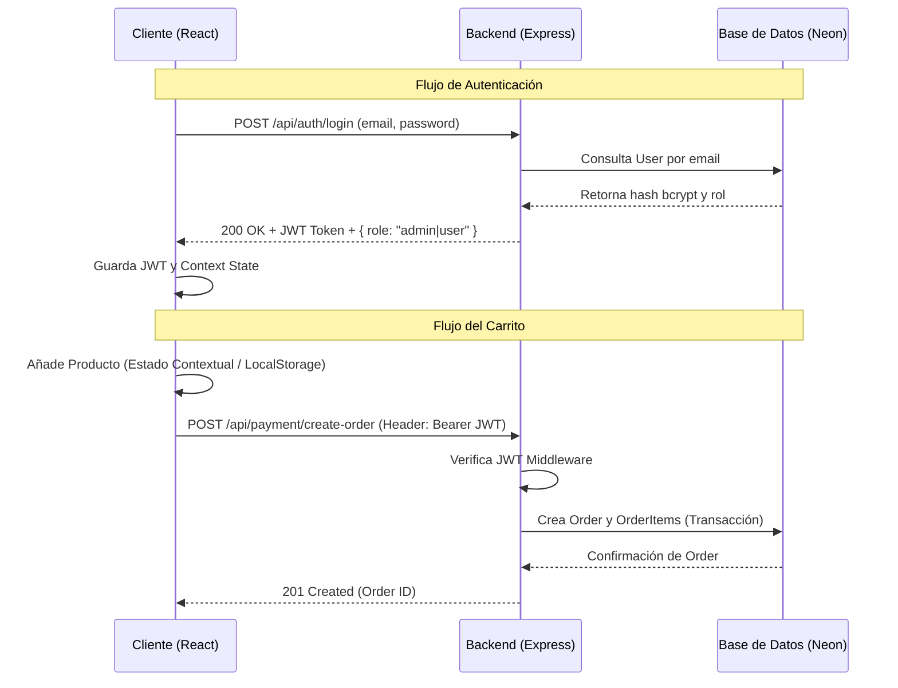

# 🚲 New-North - E-commerce Platform

Una plataforma de comercio electrónico especializada en bicicletas (New-North), dividida en una arquitectura cliente-servidor con un frontend en **React (Vite)** y un backend RESTful en **Node.js (Express)**. El sistema integra autenticación JWT, un modelo de base de datos relacional robusto gestionado por **Prisma ORM**, y persistencia en la nube mediante **Neon PostgreSQL** y **Cloudinary**.

---

## 🛠 Arquitectura del Sistema

El proyecto sigue una estructura de monorepositorio con dos paquetes independientes:

- `/ecommerce-frontend`: Single Page Application (SPA) construida en React.
- `/ecommerce-backend`: API RESTful construida en Node.js.

### 🛠️ Tecnologías Utilizadas

**Frontend:**
- **React 18** + **Vite**: Para la construcción y desarrollo rápido de la interfaz de usuario.
- **Tailwind CSS**: Framework de utilidades para el diseño ágil de los componentes.
- **React Router DOM**: Gestión de navegación y rutas de la aplicación.
- **Axios**: Cliente HTTP para interactuar con la API.
- **React Hook Form**: Gestión de validación y envío de formularios.
- **Context API (`useReducer`)**: Manejo del estado global para la Autenticación y el Carrito.

**Backend & Infraestructura:**
- **Node.js** + **Express**: Servidor HTTP principal y enrutamiento REST.
- **Prisma ORM**: Interacción moderna y tipada con la base de datos.
- **Neon PostgreSQL**: Base de datos relacional serverless alojada en la nube.
- **JSON Web Tokens (JWT)** + **Bcryptjs**: Autenticación, autorización de rutas y encriptación de contraseñas.
- **Cloudinary** + **Multer**: Procesamiento, subida y distribución (CDN) de imágenes.
- **CORS**: Habilitado para intercomunicación segura entre dominios.

---

## 💾 Esquemas de Datos (Prisma)

El modelo de datos principal está enfocado en la flexibilidad del catálogo y la trazabilidad de los pedidos.

```prisma
model User {
  id        String   @id @default(cuid())
  email     String   @unique
  password  String
  role      String   @default("user") // Roles: 'user' | 'admin'
  orders    Order[]
}

model Product {
  id            String   @id @default(cuid())
  name          String
  brand         String?
  type          String?  // Ej: mountain, ruta
  price         Decimal  @db.Decimal(10, 2)
  images        String[] @default([]) // Galería en Cloudinary
  videoUrl      String?  
  stock         Int      @default(0)
  featured      Boolean  @default(false)
  orderItems    OrderItem[]
}

model Order {
  id        String      @id @default(cuid())
  userId    String
  total     Decimal     @db.Decimal(10, 2)
  status    String      @default("pending")
  items     OrderItem[]
}
```

---

## 🔄 Flujo del Sistema (Mermaid)

El siguiente diagrama detalla la interacción entre el cliente (Frontend), el servidor (Backend) y la persistencia durante el flujo principal de autenticación y compras.



---

## ⚙️ Características Técnicas Destacadas

1. **Autenticación Centralizada:**
   - Middleware `auth.js` en Express verifica la validez del token en cabeceras `Authorization`.
   - Frontend intercepta 401s a través de Axios interceptors, limpiando estado de forma segura.
   - Restricción de acceso a `/admin/productos` verificando estado global y `user.role === 'admin'`.
2. **Gestión de Medios Optimizada:**
   - Procesamiento de imágenes mediante `multer` en memoria.
   - Subida directa a Cloudinary y persistencia de URLs en formato arreglo (`String[]`).
3. **Estado Compartido y Eficiencia UI:**
   - Contextos dedicados (`AuthContext`, `CartContext`) mediante `useReducer` y estado persistido.
   - Manejo avanzado de eventos globales en el DOM (Ej: Event listeners para *click-outside*).
4. **Módulos Específicos de Negocio:**
   - Formularios dinámicos validados y enlazados a intenciones de venta directa (**Test Rides**).
   - Componentes interactivos basados en el rubro de ciclismo.

---

## 🚀 Instalación y Configuración (Desarrollo)

### Requisitos Previos
- Node.js (v18+)
- Base de datos PostgreSQL (local o Neon) y una cuenta de Cloudinary.

### 1. Inicializar el Backend

```bash
cd ecommerce-backend
npm install

# Configuración del entorno
# Crear .env con base en .env.example:
# DATABASE_URL="tu_connection_string"
# JWT_SECRET="tu_secreto"
# PORT=3000

# Sincronizar esquema y poblar datos base
npm run db:push
npm run db:seed

# Arrancar servidor en modo dev
npm run dev
```

### 2. Inicializar el Frontend

```bash
cd ecommerce-frontend
npm install

# Configuración del entorno
# Crear .env con base en .env.example:
# VITE_API_URL="http://localhost:3000"

# Arrancar entorno Vite
npm run dev
```

---

## 🔒 Credenciales de Pruebas y Semilla de Datos

Si se ejecutó el comando `npm run db:seed` en la fase de configuración, la base de datos se populará con productos demo y el sistema contará con los siguientes accesos:

- **Email:** `admin@admin.com`
- **Contraseña:** `admin123456`
- **Rol:** `admin` (Concediendo acceso total al Panel Administrativo y API CRUD)
